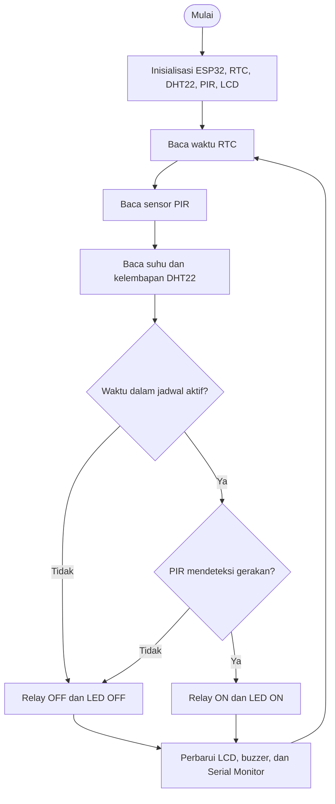

# 🦟 Sistem Pengusir Nyamuk Otomatis Terjadwal Berbasis ESP32

<p align="center">
  
  
  
  
</p>

<p align="center">
  <b>Simulasi sistem pengusir nyamuk otomatis menggunakan ESP32, dua sensor (DHT22 dan PIR), RTC DS1307, serta relay sebagai aktuator utama.</b>
</p>

---

## 📖 Deskripsi

Proyek ini merupakan simulasi **Sistem Pengusir Nyamuk Otomatis Terjadwal berbasis Internet of Things (IoT)** yang dibuat menggunakan ESP32 dan Wokwi.

Sistem menggabungkan penjadwalan waktu dari RTC DS1307 dengan deteksi gerakan dari sensor PIR HC-SR501. Perangkat simulasi hanya akan diaktifkan ketika waktu berada dalam rentang jadwal dan sensor PIR mendeteksi gerakan.

Sensor DHT22 digunakan untuk membaca suhu dan kelembapan lingkungan. Informasi waktu, suhu, kelembapan, dan status relay ditampilkan melalui LCD 16×2 I2C serta Serial Monitor.

> **Catatan:** Proyek ini merupakan simulasi logika kendali. Relay hanya menjadi representasi sakelar perangkat pengusir nyamuk; simulasi tidak menghasilkan efek pengusiran nyamuk secara fisik.

## 🎯 Tujuan

1. Menerapkan konsep IoT dan sistem tertanam menggunakan ESP32.
2. Memenuhi kebutuhan proyek dengan **minimal dua sensor dan satu aktuator**.
3. Mengimplementasikan penjadwalan menggunakan RTC DS1307.
4. Membaca suhu dan kelembapan menggunakan DHT22.
5. Mendeteksi gerakan menggunakan PIR HC-SR501.
6. Mengendalikan relay berdasarkan jadwal dan kondisi sensor.
7. Menampilkan informasi sistem melalui LCD dan Serial Monitor.

## ✅ Persyaratan Sensor dan Aktuator

| Kategori | Komponen | Peran |
|---|---|---|
| Sensor 1 | DHT22 | Mengukur suhu dan kelembapan udara |
| Sensor 2 | PIR HC-SR501 | Mendeteksi gerakan |
| Modul waktu | RTC DS1307 | Menyediakan waktu untuk penjadwalan |
| Aktuator utama | Relay Module | Mengendalikan ON/OFF perangkat simulasi |
| Indikator | LED merah | Menunjukkan status relay |
| Indikator | Buzzer | Berbunyi sesaat ketika status relay berubah |
| Antarmuka | LCD 16×2 I2C | Menampilkan data sensor dan status sistem |

RTC DS1307 adalah modul pencatat waktu (RTC), bukan salah satu dari dua sensor utama yang dihitung untuk persyaratan proyek.

## ✨ Fitur

- ⏰ **Penjadwalan otomatis:** dua rentang waktu aktif yang dapat diubah melalui kode.
- 🌡️ **Monitoring suhu:** pembacaan suhu dari DHT22.
- 💧 **Monitoring kelembapan:** pembacaan kelembapan dari DHT22.
- 🚶 **Deteksi gerakan:** pembacaan output digital PIR HC-SR501.
- ⚡ **Kontrol relay:** relay aktif hanya ketika jadwal aktif dan PIR mendeteksi gerakan.
- 💡 **LED indikator:** mengikuti status relay.
- 🔔 **Buzzer:** notifikasi singkat saat status relay berubah.
- 🖥️ **LCD dan Serial Monitor:** menampilkan informasi sistem.

## 🧠 Logika Sistem

Relay aktif apabila kedua kondisi berikut terpenuhi secara bersamaan:

1. Waktu RTC berada di salah satu jadwal aktif.
2. Output sensor PIR bernilai HIGH (gerakan terdeteksi).

Sensor DHT22 berfungsi untuk monitoring lingkungan dan tidak menjadi syarat ON/OFF relay pada versi program ini.

### Tabel kebenaran

| Jadwal aktif | PIR mendeteksi gerakan | Relay |
|---|---|---|
| Tidak | Tidak | OFF |
| Tidak | Ya | OFF |
| Ya | Tidak | OFF |
| Ya | Ya | ON |

### Diagram alur



## 🔌 Komponen

| No. | Komponen | Jumlah | Keterangan |
|---:|---|---:|---|
| 1 | ESP32 DevKit V1 | 1 | Mikrokontroler |
| 2 | DHT22 | 1 | Sensor suhu dan kelembapan |
| 3 | PIR HC-SR501 | 1 | Sensor gerakan |
| 4 | RTC DS1307 | 1 | Modul waktu |
| 5 | Relay Module | 1 | Aktuator utama |
| 6 | LCD 16×2 I2C | 1 | Tampilan |
| 7 | LED merah | 1 | Indikator |
| 8 | Resistor 220 Ω | 1 | Pembatas arus LED |
| 9 | Buzzer | 1 | Indikator suara |

## 📌 Pin Configuration ESP32

Pin berikut sesuai dengan file `diagram.json` di repository.

### DHT22

| Pin DHT22 | ESP32 |
|---|---|
| VCC | 3V3 |
| SDA / DATA | GPIO 4 |
| GND | GND |

### PIR HC-SR501

| Pin PIR | ESP32 |
|---|---|
| VCC | 5V |
| OUT | GPIO 27 |
| GND | GND |

### RTC DS1307

| Pin RTC | ESP32 |
|---|---|
| 5V | 5V |
| SDA | GPIO 21 |
| SCL | GPIO 22 |
| GND | GND |

### Relay Module

| Pin Relay | ESP32 |
|---|---|
| VCC | 5V |
| IN | GPIO 23 |
| GND | GND |

### LCD 16×2 I2C

| Pin LCD | ESP32 |
|---|---|
| VCC | 5V |
| SDA | GPIO 21 |
| SCL | GPIO 22 |
| GND | GND |

RTC dan LCD berbagi jalur komunikasi I2C pada GPIO 21 (SDA) dan GPIO 22 (SCL).

### LED dan Buzzer

| Komponen | Koneksi |
|---|---|
| LED anoda (+) | GPIO 19 melalui resistor 220 Ω |
| LED katoda (-) | GND |
| Buzzer pin 1 (+) | GPIO 18 |
| Buzzer pin 2 (-) | GND |

> **Penting untuk perangkat fisik:** konfigurasi 5V pada RTC DS1307 dan LCD I2C adalah konfigurasi simulasi sesuai rangkaian Wokwi. Pastikan jalur SDA/SCL tidak menarik GPIO ESP32 (3,3 V) ke 5 V. Gunakan level shifter atau rangkaian pull-up yang sesuai. Periksa juga kompatibilitas tegangan input relay. Jangan menghubungkan beban AC rumah pada rangkaian breadboard atau tanpa proteksi dan keahlian yang sesuai.

## ⏰ Jadwal Operasional

Program saat ini menggunakan dua rentang jadwal:

| Periode | Mulai | Selesai | Perilaku |
|---|---:|---:|---|
| Jadwal 1 | 18:00 | 18:30 | Relay dapat ON jika PIR HIGH |
| Jadwal 2 | 20:00 | 20:30 | Relay dapat ON jika PIR HIGH |
| Di luar jadwal | — | — | Relay OFF |

Rentang waktu menggunakan batas akhir eksklusif. Contoh: pada pukul 18:30, jadwal pertama sudah tidak aktif.

Untuk mengubah jadwal, edit bagian berikut di `sketch.ino`:

```cpp
const int MULAI_1 = 18 * 60;
const int SELESAI_1 = 18 * 60 + 30;

const int MULAI_2 = 20 * 60;
const int SELESAI_2 = 20 * 60 + 30;
```

## 📁 Struktur Repository

```text
Projek-IOT/
├── README.md
├── diagram.json
├── libraries.txt
├── sketch.ino
├── wokwi-project.txt
└── y namuk (1).zip
```

File utama:

| File | Fungsi |
|---|---|
| `diagram.json` | Susunan komponen dan koneksi kabel Wokwi |
| `libraries.txt` | Daftar library yang digunakan Wokwi |
| `sketch.ino` | Program utama ESP32 |
| `wokwi-project.txt` | Tautan proyek simulasi Wokwi |
| `README.md` | Dokumentasi proyek |

## 🧩 Library

Library yang digunakan tercantum di `libraries.txt`:

```text
RTClib
DHT sensor library
LiquidCrystal I2C
```

Library tersebut digunakan untuk:

- **RTClib:** komunikasi dengan RTC DS1307.
- **DHT sensor library:** membaca sensor DHT22.
- **LiquidCrystal I2C:** mengendalikan LCD 16×2 melalui I2C.

## 🚀 Cara Menjalankan Simulasi

1. Buka [Wokwi](https://wokwi.com/).
2. Buka proyek melalui tautan Wokwi pada file `wokwi-project.txt`, atau impor file `diagram.json`, `sketch.ino`, dan `libraries.txt` ke proyek ESP32 baru.
3. Pastikan komponen dan wiring sesuai tabel pin configuration.
4. Periksa isi `libraries.txt`.
5. Jalankan **Start Simulation**.
6. Buka Serial Monitor untuk melihat pembacaan sensor dan status sistem.
7. Klik komponen PIR pada simulator untuk menguji perubahan output gerakan.
8. Uji jadwal dengan mengubah waktu awal RTC pada kode.

### Pengaturan waktu RTC untuk pengujian

Di `setup()`, program saat ini mengatur RTC ke:

```cpp
rtc.adjust(DateTime(2026, 11, 4, 18, 5, 0));
```

Artinya, setiap ESP32 di-reset, waktu RTC diatur ulang menjadi **4 November 2026 pukul 18:05:00**. Pada waktu tersebut jadwal pertama aktif. Relay tetap membutuhkan output PIR HIGH agar menyala.

Untuk pengujian dari awal jadwal, ubah waktu menjadi pukul 17:55:

```cpp
rtc.adjust(DateTime(2026, 11, 4, 17, 55, 0));
```

Untuk penggunaan normal setelah waktu RTC telah diatur, komentari baris `rtc.adjust(...)` agar waktu tidak di-reset setiap perangkat dimulai ulang. Pastikan RTC sudah memiliki waktu yang benar.

## 🧪 Skenario Pengujian

Gunakan tabel berikut sebagai acuan pengujian:

| No. | Waktu RTC | PIR | Jadwal | Hasil relay |
|---:|---|---|---|---|
| 1 | 17:55 | HIGH | Tidak aktif | OFF |
| 2 | 18:00 | LOW | Aktif | OFF |
| 3 | 18:00 | HIGH | Aktif | ON |
| 4 | 18:15 | HIGH | Aktif | ON |
| 5 | 18:30 | HIGH | Tidak aktif | OFF |
| 6 | 19:00 | HIGH | Tidak aktif | OFF |
| 7 | 20:00 | LOW | Aktif | OFF |
| 8 | 20:00 | HIGH | Aktif | ON |
| 9 | 20:30 | HIGH | Tidak aktif | OFF |

Pengujian sensor DHT22 dilakukan dengan mengubah nilai suhu dan kelembapan pada panel komponen Wokwi, kemudian memeriksa hasilnya di LCD atau Serial Monitor.

## 🖥️ Informasi Tampilan

LCD 16×2 digunakan untuk menampilkan:

- Baris pertama: suhu dan kelembapan.
- Baris kedua: waktu RTC dan status relay.

Serial Monitor menampilkan:

- Waktu saat ini.
- Suhu.
- Kelembapan.
- Status deteksi PIR.
- Status jadwal.
- Status relay.

## 🛠️ Troubleshooting

| Masalah | Pemeriksaan / Solusi |
|---|---|
| RTC tidak ditemukan | Periksa VCC, GND, SDA GPIO 21, dan SCL GPIO 22. |
| LCD kosong | Periksa alamat I2C (kode menggunakan 0x27), wiring, dan kontras LCD. |
| DHT22 menghasilkan NaN | Periksa pin DATA GPIO 4 dan library DHT. |
| PIR tidak berubah | Tunggu stabilisasi sensor dan periksa output GPIO 27. |
| Relay terbalik | Ubah nilai `RELAY_ACTIVE_LOW` sesuai modul. |
| Waktu selalu kembali | Periksa apakah `rtc.adjust(...)` masih dijalankan saat boot. |
| Library tidak ditemukan | Periksa nama library di `libraries.txt`. |

## 🔮 Pengembangan Selanjutnya

- [ ] Menambahkan dashboard monitoring berbasis web.
- [ ] Integrasi Blynk untuk kontrol melalui smartphone.
- [ ] Mengatur jadwal melalui antarmuka pengguna.
- [ ] Menambahkan riwayat data suhu dan kelembapan.
- [ ] Menyimpan log aktivitas relay.
- [ ] Menambahkan pengaturan durasi aktif setelah gerakan terdeteksi.
- [ ] Menambahkan notifikasi melalui jaringan Wi-Fi.

## 🔐 Keselamatan

Proyek ini adalah simulasi Wokwi dan bukan perangkat pengusir nyamuk siap pakai. Relay hanya merepresentasikan aktuator/sakelar.

Jika dikembangkan menjadi perangkat nyata:

- Gunakan catu daya yang sesuai dengan spesifikasi setiap modul.
- Pastikan kompatibilitas logika 3,3 V ESP32 dengan modul RTC, LCD, dan relay.
- Gunakan isolasi dan proteksi yang sesuai untuk beban listrik.
- Jangan menghubungkan tegangan AC langsung ke breadboard atau GPIO ESP32.
- Pertimbangkan keselamatan manusia dan hewan terhadap jenis perangkat pengusir nyamuk yang digunakan.

## 👨‍💻 Informasi Proyek

| Keterangan | Detail |
|---|---|
| Nama proyek | Sistem Pengusir Nyamuk Otomatis Terjadwal |
| Platform | Wokwi Simulator |
| Mikrokontroler | ESP32 DevKit V1 |
| Bahasa pemrograman | Arduino C++ |
| Sensor 1 | DHT22 |
| Sensor 2 | PIR HC-SR501 |
| Modul waktu | RTC DS1307 |
| Aktuator utama | Relay Module |
| Antarmuka | LCD 16×2 I2C dan Serial Monitor |

## 🖼️ Screenshoot Prototype Wokwi


## 📜 Lisensi

Proyek ini dapat menggunakan lisensi MIT. Tambahkan file `LICENSE` berisi teks lisensi MIT apabila ingin mendistribusikan kode dengan ketentuan tersebut.

---

<p align="center">
  <b>🦟 Smart Mosquito Repellent System</b><br>
  Automated Scheduling • Environmental Monitoring • Motion Detection<br>
  <i>Developed with ESP32 and Wokwi</i>
</p>
